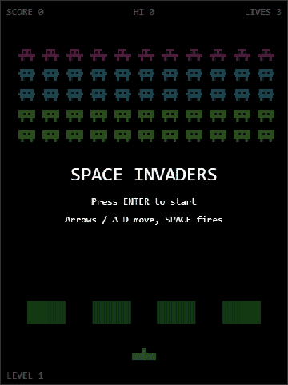

<div align="center">

# 👾 SPACE INVADERS 👾

**The 1978 arcade classic, rebuilt for the browser with TypeScript and HTML Canvas.**




_Gameplay captured from this very build: shields crumbling, invaders marching, lives ticking down._

</div>

---

## Play it

```bash
git clone https://github.com/ChrisBrooksbank/spaceinvaders.git
cd spaceinvaders
npm install
npm run dev
```

Open the URL Vite prints (usually <http://localhost:5173>).

### Controls

| Key                | Action           |
| ------------------ | ---------------- |
| `←` `→` or `A` `D` | Move your cannon |
| `Space`            | Fire             |
| `Enter`            | Start / restart  |

### Rules of engagement

- **3 lives.** An invader bomb costs you one.
- **Score:** 🟣 top row = **30**, 🔵 middle rows = **20**, 🟢 bottom rows = **10**.
- **4 destructible shields** erode from both your shots and theirs, so use them wisely.
- Invaders **speed up as their numbers dwindle**, just like the original.
- Clear the wave and the next one starts **faster**.
- You lose if your lives run out **or** the invaders reach the ground.
- Your **high score is saved** in `localStorage`.

---

## Under the hood

The game logic is **pure and separate from rendering**, so everything that matters is unit-tested without a browser.

```
src/
├── game/            # Pure logic: no DOM, no canvas
│   ├── update.ts        # update(state, input, dt) -> state  (fixed timestep)
│   ├── invaders.ts      # formation march, speed-up, bombs
│   ├── player.ts        # cannon movement and firing
│   ├── shields.ts       # erosion
│   ├── collisions.ts    # AABB hit detection
│   ├── gameover.ts      # win/lose transitions
│   └── highscore.ts     # localStorage persistence
├── render.ts        # Canvas drawing only
├── input.ts         # Keyboard state -> game Input
├── loop.ts          # requestAnimationFrame + fixed-timestep accumulator
└── main.ts          # Wiring
```

| Command            | What it does                            |
| ------------------ | --------------------------------------- |
| `npm run dev`      | Dev server with hot reload              |
| `npm run build`    | Typecheck + production build            |
| `npm run test:run` | Run the Vitest suite once               |
| `npm run check`    | Typecheck + lint + format check + tests |

Stack: **TypeScript** (strict) · **Vite** · **Vitest** · **ESLint** · **Prettier**.

---

# 📜 The history of Space Invaders

## One man, one year, one custom computer

In 1977 **Tomohiro Nishikado**, a young engineer at the Japanese company **Taito**, set out to make a video game. There was a problem: the hardware he needed didn't exist. So he **designed the arcade board himself** and wrote the software for it, largely alone, around the new Intel 8080 microprocessor. It took about a year.

_Space Invaders_ hit Japanese arcades in **1978** and changed everything.

## Where the idea came from

Nishikado has said his inspirations were a mix of:

- **Atari's _Breakout_** (1976). He loved the feeling of destroying a wall of targets and wanted to turn that into something where the targets fight back.
- **H. G. Wells' _The War of the Worlds_**. The octopus-like Martians shaped the look of the aliens, and the crab, squid, and octopus designs are still instantly recognisable decades later.
- **Science fiction cinema**, notably _Star Wars_ (1977), which helped sell the idea of a space theme.

## Why aliens? (Because planes were too hard)

The first prototypes featured **tanks, warships, and fighter planes**, but Nishikado couldn't make them move convincingly on the hardware. Then there was a cultural problem: he's said that shooting at human enemies felt wrong, and he wanted to avoid depicting people being killed. Aliens solved both problems at once. The working title was reportedly _Space Monsters_, before it became _Space Invaders_.

## The happy accident that defined the game

Here's the legend every game designer loves. In Nishikado's early builds, the hardware struggled to move all 55 invaders at once. As you shot them down, the processor had **less to draw, so the remaining invaders moved faster**.

He hadn't planned that. But he realised it created a thrilling, escalating tension, a last lonely invader sprinting across the screen. **He kept the "bug" as a feature.** It's now one of the most famous accidental mechanics in video game history.

## The heartbeat

The game's soundtrack is just **four descending bass notes on a loop**, one per step of the invaders' march. Because the march speeds up as invaders die, the tempo climbs with it, so the "music" literally becomes a heartbeat that quickens as your doom approaches. It's arguably the first example of **dynamic game audio** that responds to gameplay.

## Colour from cellophane

The original cabinets were **black-and-white**. To get colour, Taito stuck **strips of coloured cellophane over the screen**, so the top of the display glowed one colour and the bottom another. The invaders changed colour as they moved through the bands. The 1979 sequel _Space Invaders Part II_ brought true colour and an attract mode.

## Pocket-sized phenomenon

| Year   | Milestone                                                                                                          |
| ------ | ------------------------------------------------------------------------------------------------------------------ |
| 1978   | Released in Japan by Taito; licensed to **Midway** for North America later that year                               |
| 1979   | Space Invaders Part II adds colour; the game is a worldwide hit                                                    |
| 1980   | **Atari 2600 port**, the first officially licensed arcade conversion, becomes the console's "killer app"           |
| 1980   | Atari runs the **first major video game tournament**, drawing over **10,000 players** in the US                    |
| 1980s  | Cabinets spread to pizza parlours, bars, and bowling alleys worldwide; over 360,000 units sold by common estimates |
| 2000s+ | Ports to nearly everything with a screen; the invader becomes a global pop-culture icon                            |

The Atari 2600 version is a big deal in its own right: it's widely credited with **massively boosting console sales** and proving that people would buy a home console just to play arcade games at home.

## The coin-shortage legend

A famous story says the game was so popular in Japan that it caused a **national shortage of 100-yen coins**, because every coin ended up in an arcade machine. It's a delicious tale and it's repeated _everywhere_, but there's **no solid evidence** for it. Treat it as arcade folklore. What _is_ true is that Japan saw a boom in dedicated "invader houses": cafés and shops that ripped out their tables and filled the space with Space Invaders cabinets.

## Tricks, secrets and strategy

- **The mystery ship.** The red UFO across the top is worth **50 to 300 points**. Players discovered that the value isn't random: it depends on **how many shots you've fired**. Hit it on the **23rd shot** (and every 15th after that) for the full **300**.
- **The wall of death.** Invaders drop down a row each time they hit the screen edge. Let them reach the bottom and it's game over, no matter how many lives you have left.
- **The shields are temporary.** They erode from both sides, so smart players learn to shoot _through_ the gaps they've carved.

## The legacy

_Space Invaders_ turned video games from a novelty into a **global industry**. It established the idea of a **high-score chase**, the **lives system**, the **escalating difficulty curve**, and the **shoot-'em-up genre** that gave us _Galaxian_, _Galaga_, _Defender_, _Phoenix_, and a thousand descendants. Designers from Shigeru Miyamoto to Toru Iwatani have spoken of its influence on them.

Nishikado went on to make many more games for Taito, but he has said he never quite matched the impact of his first big one. He was, after all, designing the hardware, the software, and the art at the same time, and invented an industry's worth of conventions along the way.

_Space Invaders_ is a reminder that great design often comes from limitations. The speed-up, the heartbeat, the cellophane colour: all of it was forced by hardware that could barely do the job, and all of it is why people still play today.

---

## Credits and disclaimer

- _Space Invaders_ is a trademark of **Taito Corporation**. This is an unofficial, fan-made tribute for learning and fun, with original code and no copied assets, and it is not affiliated with or endorsed by Taito.
- Historical details are drawn from widely reported interviews with Tomohiro Nishikado and general video game history. Some of the finer points (sales figures, the working title, the coin shortage) vary between sources, so please treat the numbers as approximate.

## License

[MIT](LICENSE) © Chris Brooksbank

<div align="center">

**Defend the Earth. Beat the high score.** 🚀

</div>
